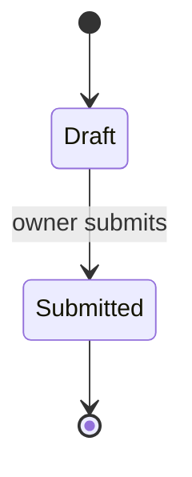

# {{title}}

<!-- State diagram of one entity: docs/specs/<capability>/diagrams/<entity>-state.md. Required when the entity
     has three or more states, or a transition allowed only under a condition (a role, a field value, a time
     limit); write the condition on the transition. specs lint needs a mermaid block starting with stateDiagram. -->

Which entity, and where its state is stored, in one or two sentences.

